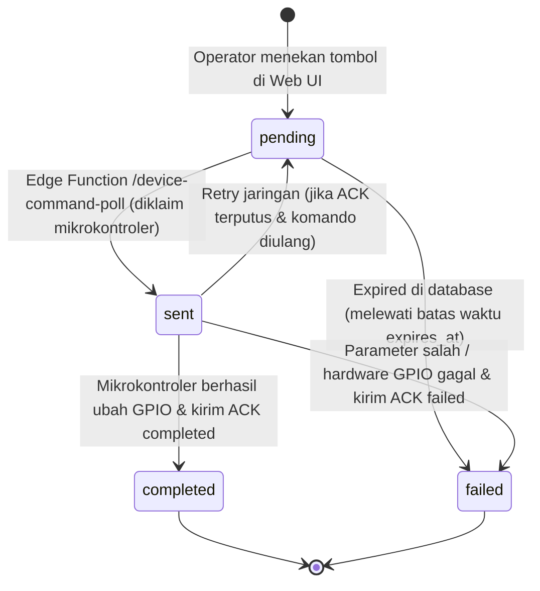

# Kontrak Komunikasi IoT: ESP8266 NodeMCU & Supabase Smart Light Trap

Dokumen ini mendefinisikan spesifikasi teknis dan kontrak komunikasi HTTP REST / HTTPS antara mikrokontroler **ESP8266 NodeMCU** (dan varian ESP32) dengan **Supabase Edge Functions** pada sistem **Smart Light Trap** (Subang, Jawa Barat).

---

## 1. Arsitektur Komunikasi & Otentikasi

### 1.1 Base URL
```
https://<PROJECT-REF>.supabase.co/functions/v1
```
*(Contoh produksi proyek: `https://xzzjfwstrpayhnpymqpq.supabase.co/functions/v1`)*

### 1.2 Header Otentikasi Perangkat (Hardware Device Authentication)
Setiap permintaan HTTPS dari perangkat mikrokontroler ke seluruh endpoint privat wajib menyertakan dua header kustom:
```http
X-Device-Code: <DEVICE_CODE>
X-Device-Token: <SECRET_DEVICE_TOKEN>
```

#### Spesifikasi Header:
| Header | Tipe | Contoh Nilai | Keterangan |
| :--- | :--- | :--- | :--- |
| `X-Device-Code` | `String` | `SLT-SBG-01` | Kode unik perangkat yang terdaftar di tabel `devices`. |
| `X-Device-Token` | `String` | *(Token rahasia acak)* | Token rahasia per-unit (plaintext dari firmware). |

#### Mekanisme Verifikasi di Backend (`supabase/functions/_shared/auth.ts`):
1. Gateway Edge Function mengekstrak `X-Device-Code` dan `X-Device-Token`.
2. Edge Function memanggil fungsi PostgreSQL:
   ```sql
   public.verify_device_token(p_device_code, p_raw_token)
   ```
3. PostgreSQL menghitung hash SHA-256 dari `p_raw_token` menggunakan `extensions.digest(p_raw_token, 'sha256')`.
4. Nilai hash dicocokkan dengan kolom `devices.api_key_hash`.
5. Memverifikasi kolom `devices.operational_status == 'active'` (perangkat dinonaktifkan / `decommissioned` ditolak dengan `403 Forbidden`).
6. **Keamanan:** Kunci `SUPABASE_SERVICE_ROLE_KEY` **hanya** digunakan di dalam runtime Edge Function di server Supabase dan **tidak pernah** dikirimkan atau disimpan di firmware ESP8266.

---

## 2. Pemetaan Pinout Hardware ESP8266 NodeMCU

### 2.1 Pemetaan Pin 4-Channel Relay Fisik
| Channel | Pin NodeMCU | GPIO ESP8266 | Fungsi Beban Lapangan | Logika Tegangan |
| :---: | :---: | :---: | :--- | :--- |
| **Relay 1** | `D1` | `GPIO 5` | Pompa Air Pengisi Baki Kuras | Active LOW (`0V = ON`, `3.3V = OFF`) |
| **Relay 2** | `D2` | `GPIO 4` | Katup Solenoid Drain / Cadangan | Active LOW (`0V = ON`, `3.3V = OFF`) |
| **Relay 3** | `D7` | `GPIO 13` | Lampu LED UV 365nm Penarik Serangga | Active LOW (`0V = ON`, `3.3V = OFF`) |
| **Relay 4** | `D0` | `GPIO 16` | Kipas Blower / Beban Aux | Active LOW (`0V = ON`, `3.3V = OFF`) |

### 2.2 Tabel Kebenaran (Truth Table) Logika Active LOW
| Perintah / Status | Level Tegangan GPIO | Kondisi Koil Relay | Kontak Relay | Status Beban Listrik |
| :---: | :---: | :---: | :---: | :---: |
| **`ON`** | `LOW` ($0\,\text{V}$) | Terbuka arus (Energized) | `COM` terhubung ke `NO` | **Menyala / Berputar** |
| **`OFF`** | `HIGH` ($3.3\,\text{V}$) | Tanpa arus (De-energized) | `COM` terhubung ke `NC` | **Mati / Standby** |

> [!IMPORTANT]
> **Safe Boot Sequence:** Pada fungsi `setup()`, semua pin relay wajib ditulis `digitalWrite(pin, HIGH)` **sebelum** memanggil `pinMode(pin, OUTPUT)`. Hal ini menjamin kontaktor relay tidak mengalami transient clicking (klik sesaat bernilai 0V) saat mikrokontroler menyala atau restart.

---

## 3. Kontrak Endpoint API

### 3.1 Endpoint 1: Polling Antrean Komando (`device-command-poll`)
Mengambil antrean perintah eksekusi yang dikirimkan oleh operator/admin dari dashboard website.

- **HTTP Method:** `GET`
- **URL Endpoint:** `/device-command-poll`
- **Headers:**
  ```http
  X-Device-Code: SLT-SBG-01
  X-Device-Token: <SECRET_DEVICE_TOKEN>
  ```
- **Query Parameter:** Tidak diperlukan (backend membaca identitas dari header).
- **Mekanisme Klaim Atomik (Claiming Mechanism):**
  - Backend mencari perintah dengan `device_id = device.id AND status = 'pending' AND expires_at > NOW()`.
  - Seketika perintah diambil, backend langsung memperbarui `status = 'sent'` untuk ID terkait. Ini memastikan tidak ada perangkat lain atau permintaan ganda yang dapat mengambil perintah yang sama.

#### Respon Jika Tidak Ada Perintah (200 OK):
```json
{
  "has_command": false,
  "commands": []
}
```

#### Respon Jika Ada Perintah (200 OK):
```json
{
  "has_command": true,
  "count": 1,
  "commands": [
    {
      "command_id": "0acda270-4fc7-4522-835b-d45dfceb0ecb",
      "command_type": "SET_RELAY",
      "parameters": {
        "relay": 1,
        "state": "ON"
      },
      "created_at": "2026-11-08T07:30:00.000Z",
      "expires_at": "2026-11-08T08:30:00.000Z"
    }
  ]
}
```

---

### 3.2 Endpoint 2: Konfirmasi Eksekusi (`device-command-ack`)
Melaporkan hasil eksekusi hardware setelah perintah diproses.

- **HTTP Method:** `POST`
- **URL Endpoint:** `/device-command-ack`
- **Headers:**
  ```http
  Content-Type: application/json
  X-Device-Code: SLT-SBG-01
  X-Device-Token: <SECRET_DEVICE_TOKEN>
  ```

#### Request Body - Eksekusi Berhasil (Hardened Schema):
```json
{
  "command_id": "0acda270-4fc7-4522-835b-d45dfceb0ecb",
  "status": "completed",
  "result": {
    "message": "Relay 1 (D1/GPIO5) level register berhasil diset ke 0V (LOW). Status logis: ON. Beban fisik: UNMONITORED (tanpa sensor arus).",
    "relay": 1,
    "relay_name": "D1",
    "state": "ON",
    "gpio_pin": 5,
    "gpio_electrical_level": 0,
    "gpio_level_verified": true,
    "relay_logical_state": "ON",
    "physical_load_feedback": "UNMONITORED",
    "hardware_disclaimer": "digitalRead() hanya memverifikasi level logika GPIO register mikrokontroler. Tidak membuktikan beban fisik aktif tanpa sensor arus eksternal.",
    "executed_by": "ESP8266_NodeMCU",
    "firmware": "v2.6.0-esp8266-nodemcu",
    "timestamp_ms": 142080
  },
  "error_message": null
}
```

#### Request Body - Eksekusi Gagal:
```json
{
  "command_id": "0acda270-4fc7-4522-835b-d45dfceb0ecb",
  "status": "failed",
  "result": {
    "executed_by": "ESP8266_NodeMCU",
    "firmware": "v2.6.0-esp8266-nodemcu",
    "timestamp_ms": 142100
  },
  "error_message": "Nomor channel relay tidak valid: 5 (harus 1 s.d. 4)"
}
```

#### Respon Sukses (200 OK):
```json
{
  "success": true,
  "command_id": "0acda270-4fc7-4522-835b-d45dfceb0ecb",
  "updated_status": "completed"
}
```

#### Efek Samping Database:
1. Kolom `status` di tabel `device_commands` diperbarui menjadi `completed` atau `failed`.
2. Kolom `completed_at` diisi timestamp UTC saat ini.
3. Jika perintah adalah `SET_RELAY` untuk relay 3 (Lampu UV), backend secara otomatis menyinkronkan kolom `devices.lamp_status`.

---

### 3.3 Endpoint 3: Status Perangkat & Heartbeat Diagnostik (`device-status`)
Melaporkan siklus hidup perangkat, kesehatan koneksi, dan status fisik relay tanpa mengotori tabel telemetri sensor.

- **HTTP Method:** `POST`
- **URL Endpoint:** `/device-status`
- **Headers:**
  ```http
  Content-Type: application/json
  X-Device-Code: SLT-SBG-01
  X-Device-Token: <SECRET_DEVICE_TOKEN>
  ```

#### Request Body:
```json
{
  "event_type": "DEVICE_RECOVERY",
  "severity": "info",
  "title": "ESP8266 Heartbeat",
  "message": "Heartbeat rutin diagnostik NodeMCU dan sinkronisasi status 4-channel relay.",
  "details": {
    "chip": "ESP8266_NodeMCU",
    "firmware_version": "v2.6.0-esp8266-nodemcu",
    "free_heap_bytes": 41280,
    "uptime_seconds": 360,
    "wifi_rssi_dbm": -65,
    "ip_address": "192.168.1.105",
    "pending_acks_in_queue": 0,
    "dead_letter_acks_count": 0,
    "relays": {
      "relay_1": {
        "label": "Relay 1 (D1/GPIO5 - Pompa Baki)",
        "pin_name": "D1",
        "gpio": 5,
        "is_active": false,
        "logical_state": "OFF",
        "gpio_pin_level": 1,
        "physical_load_feedback": "UNMONITORED"
      },
      "relay_2": {
        "label": "Relay 2 (D2/GPIO4 - Solenoid Drain)",
        "pin_name": "D2",
        "gpio": 4,
        "is_active": false,
        "logical_state": "OFF",
        "gpio_pin_level": 1,
        "physical_load_feedback": "UNMONITORED"
      },
      "relay_3": {
        "label": "Relay 3 (D7/GPIO13 - Lampu LED UV)",
        "pin_name": "D7",
        "gpio": 13,
        "is_active": true,
        "logical_state": "ON",
        "gpio_pin_level": 0,
        "physical_load_feedback": "UNMONITORED"
      },
      "relay_4": {
        "label": "Relay 4 (D0/GPIO16 - Kipas / Aux)",
        "pin_name": "D0",
        "gpio": 16,
        "is_active": false,
        "logical_state": "OFF",
        "gpio_pin_level": 1,
        "physical_load_feedback": "UNMONITORED"
      }
    }
  }
}
```

#### Respon Sukses (200 OK):
```json
{
  "success": true,
  "event_id": "e45b1234-5678-4321-9abc-def012345678",
  "device_code": "SLT-SBG-01"
}
```

#### Efek Samping Database:
1. Menyimpan rekaman audit ke tabel `device_events`.
2. Memperbarui `devices.last_seen_at = NOW()` dan `devices.connection_status = 'online'`.
3. Memastikan unit tampak hijau / online pada dashboard web secara berkala.

---

### 3.4 Endpoint 4: Telemetri Lingkungan (`device-telemetry`)
*(Hanya digunakan jika mikrokontroler terhubung dengan sensor fisik tambahan seperti INA226 atau sensor analog).*

> [!CAUTION]
> **Kebijakan Zero Fake Telemetry:**
> Jika modul ESP8266 Anda saat ini **hanya mengendalikan 4 relay** tanpa sensor fisik daya/lingkungan:
> **JANGAN** mengirimkan payload fiktif (suhu palsu 26°C, kelembaban palsu 80%, atau tegangan palsu 12.8V).
> Firmware telah mengonfigurasi `#define ENABLE_ENVIRONMENTAL_SENSORS false`.

---

## 4. Siklus Hidup Command (State Machine)

Perintah yang dibuat melalui website melewati tahapan siklus hidup sebagai berikut:



---

## 5. Empat Pilar Hardening Firmware (Final Hardening)

1. **Antrean ACK Multi-Slot (`AckQueueManager`):**
   - Mendukung hingga 8 ACK tertunda secara bersamaan dalam antrean FIFO.
   - Menggunakan algoritma Exponential Backoff ($2s, 4s, 8s, 16s, 32s$).
   - Dead-letter counter untuk mencegah kebuntuan antrean jika ada kegagalan permanen.

2. **Idempotensi Penuh dengan Status Retention (`CommandHistoryManager`):**
   - Riwayat 8 komando di RAM dan 4 komando di flash EEPROM non-volatile.
   - Jika polling server mengulang ID yang sama, **aktuator GPIO sama sekali tidak digerakkan kembali**.
   - Status kegagalan maupun keberhasilan dipertahankan secara konsisten.

3. **Pemisahan Verifikasi Hardware & Disklaimer:**
   - Menegaskan bahwa `digitalRead()` adalah verifikasi output register mikrokontroler, bukan bukti kontaktor relay fisik.
   - Parameter `physical_load_feedback: "UNMONITORED"` dicantumkan secara eksplisit dalam setiap respons ACK.

4. **Audit Keselamatan Aktuator (Actuator Safety):**
   - Safe boot sequence: Menulis `HIGH` sebelum `pinMode(OUTPUT)`. Seluruh aktuator dijamin OFF saat boot.
   - Proteksi interlock: Katup solenoid drain dan pompa pengisi baki dijamin tidak dapat aktif bersamaan dalam siklus `FORCE_WATER_CHANGE`.
   - Shutdown darurat: Fungsi `emergencyShutdownAllRelays()` siap mematikan seluruh beban kapan pun diperlukan.
