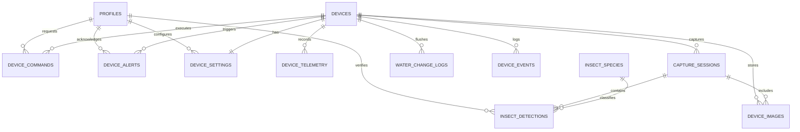

# DOKUMENTASI SKEMA DATABASE POSTGRESQL (SUPABASE)

## Smart Light Trap IoT Agritech System - Subang, Jawa Barat

Skema database dirancang untuk keandalan tinggi, anti-duplikasi paket telemetri, partisi time-series, keamanan Row Level Security (RLS), serta integritas relasional data sensor dan hasil computer vision.

---

### Entity Relationship Diagram (ERD) Ringkas

---

## Rincian Tabel

### 1. `profiles`
Menyimpan profil agronomis dan operator teknis yang terikat langsung ke `auth.users` Supabase.
- **`id`** (`UUID`, PK, REFERENCES `auth.users(id)` ON DELETE CASCADE)
- **`full_name`** (`TEXT`, NOT NULL): Nama lengkap operator.
- **`email`** (`TEXT`): Alamat email terdaftar.
- **`role`** (`TEXT`, CHECK `role IN ('admin', 'operator', 'viewer')`): Hak akses sistem.
- **`assigned_region`** (`TEXT`, DEFAULT `'Subang, Jawa Barat'`): Cakupan wilayah tugas.
- **`created_at`**, **`updated_at`** (`TIMESTAMPTZ`).
- *Aturan*: Pengguna tidak dapat menaikkan role sendiri. Perubahan role hanya diizinkan melalui administrator via trigger `trg_check_role_change`.

### 2. `devices`
Pusat registrasi armada perangkap pintar lapangan di Subang.
- **`id`** (`UUID`, PK)
- **`device_code`** (`VARCHAR(64)`, UNIQUE, NOT NULL): Kode unik unit (contoh: `SLT-SBG-01`).
- **`device_name`** (`VARCHAR(128)`, NOT NULL): Nama deskriptif unit.
- **`location_name`** (`VARCHAR(128)`, NOT NULL): Nama lokasi demplot / kelompok tani.
- **`farm_sector`** (`VARCHAR(128)`, NOT NULL): Blok sawah.
- **`latitude`**, **`longitude`** (`NUMERIC(10, 7)`): Koordinat GPS lahan.
- **`crop_type`** (`VARCHAR(64)`): Varietas padi dan HST (contoh: `Padi Ciherang HST 42`).
- **`firmware_version`** (`VARCHAR(32)`): Versi firmware ESP32-S3.
- **`esp32_chip_id`** (`VARCHAR(32)`, UNIQUE): Identitas hardware MAC / eFuse.
- **`api_key_hash`** (`VARCHAR(256)`, NOT NULL): Hash SHA-256 token rahasia per perangkat.
- **`last_seen_at`** (`TIMESTAMPTZ`): Timestamp heartbeat terakhir.
- **`connection_status`** (`VARCHAR(16)`, CHECK `IN ('online', 'offline', 'warning', 'maintenance')`): Ditentukan secara dinamis berdasarkan batas toleransi 15 menit.
- **`lamp_status`** (`BOOLEAN`): Status aktual saklar lampu UV.
- **`battery_cutoff_threshold_v`** (`NUMERIC(4, 2)`, DEFAULT `11.80`): Batas aman pemutusan beban.
- **`pest_threshold_per_night`** (`INT`, DEFAULT `50`): Ambang batas PHT.

### 3. `device_telemetry`
Data time-series pengukuran daya INA226, baki air, dan lingkungan.
- **`id`** (`UUID`, PK)
- **`device_id`** (`UUID`, FK `devices(id)` ON DELETE CASCADE)
- **`sequence_number`** (`BIGINT`, NOT NULL): Nomor urut paket dari ESP32.
- **`recorded_at`** (`TIMESTAMPTZ`, NOT NULL): Waktu pembacaan RTC DS3231.
- **`received_at`** (`TIMESTAMPTZ`, DEFAULT `NOW()`): Waktu paket diterima server.
- **Kelistrikan**: `battery_voltage`, `battery_current`, `shunt_voltage_mv`, `solar_voltage`, `solar_current`, `power_mw`, `is_charging`, `solar_irradiance_wm2`.
- **Hidraulik**: `tray_level`, `tray_level_cm`, `tank_level`, `tank_volume_liters`, `turbidity`, `is_turbid`, `drain_valve_status`, `fill_pump_status`, `safety_lockout`.
- **Lampu**: `lamp_status`, `lamp_mode`, `lamp_led_current_ma`, `lamp_wavelength_nm`, `lamp_is_healthy`.
- **Konektivitas**: `network_type`, `modem_signal_strength`, `operator`, `unsynced_microsd_packets`.
- *Constraint Anti-Duplikasi*: `UNIQUE(device_id, sequence_number)`.

### 4. `capture_sessions`
Merekam sesi penjadwalan pemotretan baki perangkap serangga.
- **`id`** (`UUID`, PK)
- **`device_id`** (`UUID`, FK `devices(id)`)
- **`session_code`** (`VARCHAR(64)`, UNIQUE)
- **`captured_at`** (`TIMESTAMPTZ`)
- **`processing_status`** (`VARCHAR(32)`, CHECK `IN ('pending', 'processing', 'completed', 'failed', 'verified')`)
- **`model_version`** (`VARCHAR(64)`)
- **`total_pests`**, **`target_pests_count`**, **`other_insects_count`**, **`avg_confidence`**
- **`is_manually_verified`** (`BOOLEAN`)

### 5. `insect_species`
Daftar master taksonomi hama padi nokturnal dan nilai ambang kendali ekonomi.
- `scirpophaga_incertulas` (Penggerek Batang Padi Kuning, Ambang: 50 ekor/malam)
- `nilaparvata_lugens` (Wereng Batang Coklat, Ambang: 80 ekor/malam)
- `spodoptera_frugiperda` (Ulat Grayak / Fall Armyworm, Ambang: 35 ekor/malam)
- `leptocorisa_oratoria` (Walang Sangit, Ambang: 40 ekor/malam)
- `cnaphalocrocis_medinalis` (Hama Putih Palsu, Ambang: 45 ekor/malam)
- `other_neutral` (Serangga Netral Non-Hama)

### 6. `insect_detections`
Deteksi individual objek serangga, bounding box persen, dan koreksi manual.
- **`id`** (`UUID`, PK)
- **`capture_session_id`** (`UUID`, FK `capture_sessions(id)`)
- **`species_code`** (`VARCHAR(64)`, FK `insect_species(id)`)
- **`bounding_box`** (`JSONB`): `{ x, y, width, height }` dalam persen resolusi.
- **`verification_status`** (`VARCHAR(32)`, CHECK `IN ('ai_detected', 'human_verified', 'human_corrected')`)
- **`verified_by`** (`UUID`, FK `profiles(id)`)

### 7. `device_images`
Metadata foto di Supabase Storage bucket privat `device-images`.
- **`id`** (`UUID`, PK)
- **`device_id`** (`UUID`, FK `devices(id)`)
- **`storage_path`** (`TEXT`): Jalur file privat (contoh: `devices/SLT-SBG-01/2026/10/photo_01.jpg`).
- **`image_width`**, **`image_height`**, **`content_type`**, **`file_size`**.

### 8. `device_alerts`
Peringatan operasional dan ambang batas hama.
- **`id`** (`UUID`, PK)
- **`device_id`** (`UUID`, FK `devices(id)`)
- **`alert_type`** (`pest_threshold`, `battery_low`, `water_critical`, `device_offline`, `sensor_fault`, `lamp_fault`)
- **`severity`** (`critical`, `warning`, `info`)
- **`status`** (`triggered`, `acknowledged`, `resolved`)
- **`acknowledged_by`**, **`acknowledged_at`**, **`action_taken`**

### 9. `device_commands`
Antrean perintah kontrol aktuator jarak jauh dengan validasi masa berlaku.
- **`id`** (`UUID`, PK)
- **`command_type`** (`FORCE_WATER_CHANGE`, `TOGGLE_LAMP`, `CAPTURE_NOW`, `SYNC_MICROSD`, `REBOOT_ESP32`, `UPDATE_FIRMWARE_OTA`, `SET_SCHEDULE`)
- **`status`** (`pending`, `sent`, `acknowledged`, `completed`, `expired`, `failed`)
- **`expires_at`**: Otomatis kedaluwarsa setelah 1 jam jika ESP32 tidak mengambil antrean.

### 10. `device_settings`
Pengaturan operasional mikrokontroler (jadwal lampu, threshold baterai, kekeruhan, durasi flushing).

### 11. `water_change_logs`
Catatan siklus hidraulik kuras dan pengisian baki air penangkap serangga.

### 12. `device_events`
Log audit kejadian mikrokontroler (boot, kehilangan sinyal modem, dry-run lockout pompa).

### 13. `system_heartbeat`
Pencatat detak sistem dan aktivitas I/O database berkala (Keep-Alive) untuk mencegah Supabase Free tier terkena auto-pause.
- **`id`** (`UUID`, PK, DEFAULT `gen_random_uuid()`)
- **`service_name`** (`VARCHAR(64)`, UNIQUE, NOT NULL): Nama identitas layanan (`smart-light-trap`).
- **`status`** (`VARCHAR(32)`, DEFAULT `'healthy'`, CHECK `status IN ('healthy', 'degraded', 'unhealthy', 'maintenance')`)
- **`last_heartbeat_at`** (`TIMESTAMPTZ`, DEFAULT `NOW()`): Waktu UTC eksekusi heartbeat terakhir.
- **`metadata`** (`JSONB`, DEFAULT `'{}'::jsonb`): Informasi pemanggil scheduler eksternal.
- **`created_at`**, **`updated_at`** (`TIMESTAMPTZ`).
- *Catatan Isolasi*: Singleton per `service_name`. Pemanggilan berulang melakukan UPDATE/UPSERT pada record yang sama dan tidak mencemari data telemetri ESP32.

