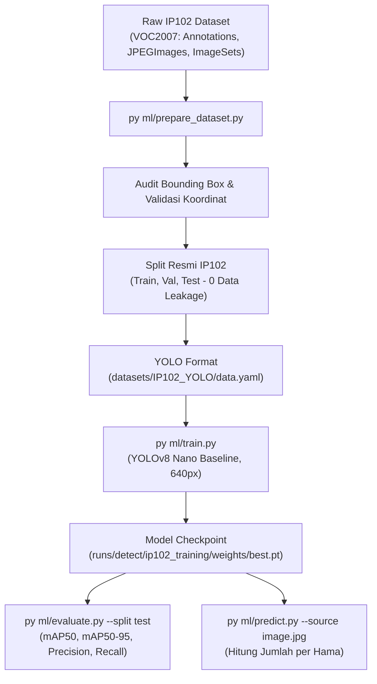

# Smart Light Trap — IP102 Dataset Preparation & YOLOv8 Training Pipeline

Sistem Computer Vision berbasis Ultralytics YOLOv8 untuk mendeteksi, mengklasifikasi, dan menghitung populasi hama pertanian nokturnal (seperti wereng coklat, wereng hijau, dan penggerek batang padi) menggunakan dataset benchmark **IP102** (CVPR 2019).

---

## 1. Arsitektur Folder Machine Learning

```text
ml/
├── configs/
│   ├── dataset_config.yaml       # Konfigurasi path dataset, split ratio, kelas prioritas
│   └── train_config.yaml         # Hyperparameter pelatihan (epochs, imgsz, batch, device)
├── src/
│   ├── __init__.py
│   ├── dataset_parser.py         # Parser XML Pascal VOC, validator koordinat, & audit data
│   ├── converter.py              # Konversi koordinat VOC ke YOLO normalisasi [0.0, 1.0]
│   ├── splitter.py               # Partisi dataset resmi IP102 (trainval/test) & data.yaml generator
│   ├── trainer.py                # Wrapper Ultralytics YOLOv8 training, checkpoint & early stopping
│   ├── evaluator.py              # Evaluator mAP50, mAP50-95, Precision, Recall pada Test Set
│   └── predictor.py              # Script inferensi, visualisasi bounding box, & penghitung hama
├── prepare_dataset.py            # CLI entrypoint preparasi & konversi dataset
├── train.py                      # CLI entrypoint pelatihan model
├── evaluate.py                   # CLI entrypoint evaluasi performa model
├── predict.py                    # CLI entrypoint inferensi gambar baru
├── DATASET_GUIDE.md              # Panduan lengkap struktur & konversi dataset
├── TRAINING_GUIDE.md             # Panduan training lokal CPU/GPU & Google Colab / Kaggle
└── MODEL_EVALUATION.md           # Panduan metrik evaluasi & benchmarking
```

---

## 2. Alur Kerja (Workflow)



---

## 3. Prasyarat & Instalasi

Pastikan Python telah terpasang dengan library yang dibutuhkan:

```bash
pip install ultralytics torch torchvision opencv-python pillow pyyaml tqdm pandas matplotlib
```

---

## 4. Perintah Cepat (Quick Start)

### A. Preparasi Dataset (VOC ke YOLO)
```bash
# Validasi dan konversi dataset lengkap
py ml/prepare_dataset.py

# Atau hanya periksa integritas anotasi tanpa konversi:
py ml/prepare_dataset.py --verify-only
```

### B. Melatih Model YOLOv8
```bash
# Pelatihan standar (otomatis mendeteksi GPU atau CPU)
py ml/train.py --epochs 50 --batch 16 --imgsz 640

# Melanjutkan pelatihan dari checkpoint terakhir:
py ml/train.py --resume
```

### C. Mengevaluasi Performa Model
```bash
# Evaluasi pada Test Set resmi IP102
py ml/evaluate.py --model runs/detect/ip102_training/weights/best.pt --split test
```

### D. Menguji Gambar Lapangan Baru
```bash
# Deteksi dan penghitungan hama pada gambar baru
py ml/predict.py --model runs/detect/ip102_training/weights/best.pt --source path/to/sample_pest.jpg
```

Output terminal akan menyajikan rekapitulasi jumlah per spesies hama:
```text
--------------------------------------------------
Hasil Deteksi Hama: sample_pest.jpg
--------------------------------------------------
- brown plant hopper: 3
- rice leafhopper: 2
Total terdeteksi : 5
Gambar hasil     : runs/predict/detected_sample_pest.jpg
--------------------------------------------------
```

---

## 5. Batasan & Integrasi Smart Light Trap

- Model YOLOv8 dijalankan pada komputer/server edge (atau mini PC Raspberry Pi / Jetson), **bukan** langsung di dalam mikrokontroler ESP8266.
- Hasil deteksi dan penghitungan populasi hama disiapkan agar nantinya dapat diintegrasikan dengan database Supabase (`capture_sessions` & `insect_detections`) melalui API inference service terpisah.
- Tidak ada modifikasi pada kode frontend React, Supabase Edge Functions, database schema, maupun firmware ESP8266.

