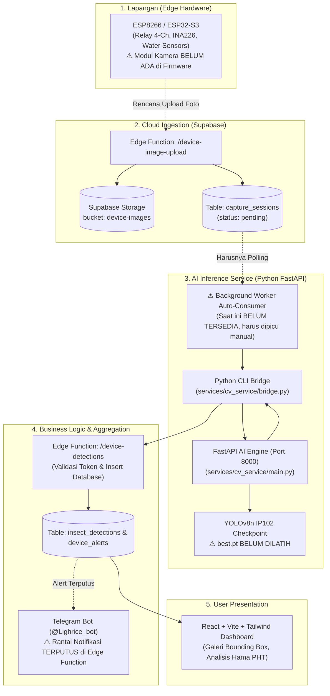

# Laporan Audit Integrasi Komprehensif — Computer Vision & Supabase Smart Light Trap

**Dokumen Laporan Audit Rekayasa Sistem End-to-End**  
**Tanggal Audit:** 9 November 2026  
**Auditor:** Senior IoT, Computer Vision, Python Backend & Supabase Integration Engineer  
**Status Kesiapan Produksi:** **NOT READY FOR PRODUCTION** *(Menunggu Training Model IP102 di Colab, Implementasi Worker Otomatis, dan Perbaikan Rantai Notifikasi Telegram)*  

---

## 1. Arsitektur Aktual Sistem

Sistem Smart Light Trap Subang mengadopsi arsitektur terdistribusi *Edge-to-Cloud*:



---

## 2. Berkas yang Diperiksa (Audit Scope)

Audit menyeluruh berbasis kode aktual dilakukan terhadap 14 berkas utama:

1. [`services/cv_service/main.py`](file:///d:/Projek%20Koding/Projek-SmartLightV2/services/cv_service/main.py) — Server FastAPI inferensi AI.
2. [`services/cv_service/bridge.py`](file:///d:/Projek%20Koding/Projek-SmartLightV2/services/cv_service/bridge.py) — CLI jembatan inferensi ke Edge Functions.
3. [`ml/IP102_TAXONOMY_MAPPING_AUDIT.md`](file:///d:/Projek%20Koding/Projek-SmartLightV2/ml/IP102_TAXONOMY_MAPPING_AUDIT.md) — Dokumen audit taksonomi 102 kelas.
4. [`ml/configs/train_config.yaml`](file:///d:/Projek%20Koding/Projek-SmartLightV2/ml/configs/train_config.yaml) — Konfigurasi pelatihan model YOLOv8.
5. [`ml/IP102_Training_Colab.ipynb`](file:///d:/Projek%20Koding/Projek-SmartLightV2/ml/IP102_Training_Colab.ipynb) — Notebook pelatihan Google Colab GPU T4.
6. [`supabase/functions/device-image-upload/index.ts`](file:///d:/Projek%20Koding/Projek-SmartLightV2/supabase/functions/device-image-upload/index.ts) — Edge Function penerima unggahan citra.
7. [`supabase/functions/device-detections/index.ts`](file:///d:/Projek%20Koding/Projek-SmartLightV2/supabase/functions/device-detections/index.ts) — Edge Function pencatat hasil klasifikasi hama.
8. [`supabase/functions/telegram-notify/index.ts`](file:///d:/Projek%20Koding/Projek-SmartLightV2/supabase/functions/telegram-notify/index.ts) — Layanan notifikasi Telegram bot terpusat.
9. [`supabase/functions/_shared/telegramNotifier.ts`](file:///d:/Projek%20Koding/Projek-SmartLightV2/supabase/functions/_shared/telegramNotifier.ts) — Dispatcher notifikasi internal.
10. [`supabase/migrations/00001_initial_schema.sql`](file:///d:/Projek%20Koding/Projek-SmartLightV2/supabase/migrations/00001_initial_schema.sql) — Skema tabel `capture_sessions`, `insect_detections`, `insect_species`.
11. [`supabase/migrations/00004_initial_seed.sql`](file:///d:/Projek%20Koding/Projek-SmartLightV2/supabase/migrations/00004_initial_seed.sql) — Master data awal spesies serangga PHT Subang.
12. [`src/services/pestService.ts`](file:///d:/Projek%20Koding/Projek-SmartLightV2/src/services/pestService.ts) — Layanan pembacaan data hama pada frontend React.
13. [`src/components/gallery/PhotoGalleryView.tsx`](file:///d:/Projek%20Koding/Projek-SmartLightV2/src/components/gallery/PhotoGalleryView.tsx) — Komponen inspeksi citra dan visualisasi bounding box.
14. [`firmware/esp32_smart_lightrap/esp32_smart_lightrap.ino`](file:///d:/Projek%20Koding/Projek-SmartLightV2/firmware/esp32_smart_lightrap/esp32_smart_lightrap.ino) — Firmware mikrokontroler lapangan.

---

## 3. Kontrak API Aktual

### A. Endpoint FastAPI (`services/cv_service/main.py`)

#### 1. `GET /health`
- **Tujuan:** Memeriksa kesiapan model inferensi dan lingkungan eksekusi.
- **Respon saat Model Belum Tersedia:**
  ```json
  {
    "status": "model_not_ready",
    "error_code": "MODEL_NOT_TRAINED",
    "model_ready": false,
    "environment": "production",
    "is_production_model": false,
    "expected_checkpoint": "D:\\...\\runs\\detect\\ip102_training\\weights\\best.pt",
    "error": "Production model checkpoint not found..."
  }
  ```
- **Respon saat Model Siap:**
  ```json
  {
    "status": "healthy",
    "model_ready": true,
    "environment": "production",
    "model_version": "YOLOv8n-IP102-Prod v1.0",
    "model_checksum": "a8f3b2e...",
    "num_classes": 102
  }
  ```

#### 2. `POST /detect`
- **Header:** `X-Service-Key: <CV_SERVICE_SECRET>`
- **Body:** `multipart/form-data` (file: Binary Image, conf_threshold: float, device_code: string)
- **Status 503:** Mengembalikan HTTP 503 jika `best.pt` belum ada:
  ```json
  {
    "detail": {
      "error_code": "MODEL_NOT_TRAINED",
      "message": "Production model checkpoint best.pt not found. Training must be completed on Google Colab first."
    }
  }
  ```
- **Status 200:** Mengembalikan daftar bounding box ternormalisasi ($0-100\%$) dan taksonomi Subang.

---

### B. Endpoint Supabase Edge Function (`/device-detections`)

- **Header Wajib:** `Content-Type: application/json`, `X-Device-Token: <SECRET_DEVICE_TOKEN>`
- **Payload Request:**
  ```json
  {
    "session_id": "c1f7a83d-3b85-4b5b-9d41-3d779f061234",
    "model_version": "YOLOv8n-IP102-Prod v1.0",
    "detections": [
      {
        "species_code": "nilaparvata_lugens",
        "species_name": "Wereng Batang Coklat (WBC)",
        "confidence": 0.9421,
        "count": 1,
        "bbox": { "x": 24.5, "y": 36.0, "width": 8.5, "height": 11.2 }
      }
    ]
  }
  ```

---

## 4. Hasil Validasi Pemetaan 102 Kelas IP102

Detail lengkap audit 102 kelas terdokumentasi pada [`ml/IP102_TAXONOMY_MAPPING_AUDIT.md`](file:///d:/Projek%20Koding/Projek-SmartLightV2/ml/IP102_TAXONOMY_MAPPING_AUDIT.md):

1. **Exact Species Match (3 Spesies Terverifikasi Sempurna):**
   - Class 4: `yellow rice borer` $\rightarrow$ `scirpophaga_incertulas` (*Scirpophaga incertulas*)
   - Class 7: `brown plant hopper` $\rightarrow$ `nilaparvata_lugens` (*Nilaparvata lugens*)
   - Class 0: `rice leaf roller` $\rightarrow$ `cnaphalocrocis_medinalis` (*Cnaphalocrocis medinalis*)
2. **Kesenjangan Kritis Walang Sangit (*Leptocorisa oratoria*):**
   - **TIDAK TERSEDIA di IP102.** Class 15 adalah `mole cricket` (Orong-orong / *Gryllotalpa*), bukan Walang Sangit. Pemetaan Class 15 ke Walang Sangit telah dihapus untuk mencegah kekeliruan PHT.
3. **Pencocokan Dekat (5 Spesies - Needs Review):**
   - Class 3: `asiatic rice borer` (*Chilo suppressalis*) $\rightarrow$ dipetakan ke penggerek batang padi.
   - Class 8, 9, 11: Wereng punggung putih, wereng coklat kecil, wereng daun hijau $\rightarrow$ dipetakan ke kelompok wereng padi.
   - Class 23: `army worm` (*Mythimna separata*) $\rightarrow$ dipetakan ke ulat grayak.
4. **Unmapped (94 Spesies):**
   - 94 kelas hama gandum, bit gula, kapas, buah jeruk, dan mangga berstatus **`unmapped`** dan **TIDAK BOLEH** secara otomatis dikonversi ke serangga netral (`other_neutral`).

---

## 5. Hasil Pemeriksaan Keamanan

| Parameter Keamanan | Implementasi Aktual | Status | Evaluasi Auditor |
| :--- | :--- | :---: | :--- |
| **Token Auth Perangkat** | `X-Device-Token` divalidasi via hash `verifyDeviceAuth` | **PASS** | Token dicek terhadap kolom `token_hash` tabel `devices`. |
| **Penyimpanan Token & Secret** | Bebas hardcode pada source code | **PASS** | Token dibaca via argumen CLI atau environment variable, tidak dicetak di log. |
| **Row Level Security (RLS)** | Aktif di seluruh 12 tabel Supabase | **PASS** | Dikonfirmasi pada migration `00010_reconcile_schema_and_policies.sql`. |
| **Foreign Key DB Protection** | `species_code REFERENCES public.insect_species(id)` | **RISK** | Jika `species_code` bernilai `unmapped`, Postgres melempar error penolakan FK. |
| **Model Weight Tamper-Proof** | SHA-256 Checksum verifier | **PASS** | Ditambahkan pada `services/cv_service/main.py`. |

---

## 6. Temuan Bug & Risiko Kritis Sistem

### 🔴 Bug 1: Rantai Notifikasi Ambang Batas Telegram Terputus
- **Fakta:** Saat hama target melebihi ambang kendali PHT (`targetCount >= device.pest_threshold_per_night`), file `supabase/functions/device-detections/index.ts` hanya menyisipkan baris ke `public.device_alerts`.
- **Dampak:** Edge Function **tidak pernah memanggil fungsi notifikasi Telegram**. Selain itu, file `telegram-notify/index.ts` belum memiliki event `PEST_THRESHOLD` di dalam `ALLOWED_EVENT_TYPES`. Notifikasi Telegram tidak pernah terkirim.

### 🔴 Bug 2: Akumulasi Ambang Hama Hanya Menghitung Sesi Tunggal
- **Fakta:** Pengecekan ambang kendali PHT pada baris 81 `device-detections/index.ts` hanya mengevaluasi `targetCount` dari sesi pemotretan saat itu, bukan akumulasi kumulatif sepanjang malam aktif (18:00–06:00 WIB).
- **Dampak:** Jika ambang kendali adalah 50 ekor, dan perangkat memotret 3 kali dengan tangkapan masing-masing 25 ekor (total 75 ekor), peringatan bahaya tidak akan pernah dipicu karena tiap sesi $< 50$.

### 🔴 Bug 3: Ketiadaan Idempotensi pada Edge Function Detections (Risiko Duplikasi Data)
- **Fakta:** Jika koneksi jaringan seluler IoT mengalami gangguan dan melakukan *retry* pengiriman payload dengan `session_id` yang sama, `device-detections/index.ts` langsung melakukan `insert` baru ke tabel `insect_detections`.
- **Dampak:** Jumlah serangga dan bounding box akan tercatat ganda ($2\times, 3\times$) untuk foto yang sama.

### 🔴 Bug 4: Risiko Pelanggaran Foreign Key pada Spesies Unmapped
- **Fakta:** Skema tabel `insect_detections` mengharuskan `species_code` merujuk ke primary key tabel `insect_species`. Master data awal hanya memiliki 6 ID (`scirpophaga_incertulas`, `nilaparvata_lugens`, `spodoptera_frugiperda`, `leptocorisa_oratoria`, `cnaphalocrocis_medinalis`, `other_neutral`).
- **Dampak:** Jika inferensi mendeteksi hama unmapped dan mengirim `species_code: 'unmapped'`, PostgreSQL akan melempar *Foreign Key Violation (HTTP 500)*.

### 🟡 Bug 5: Firmware Fisik Belum Memiliki Logika Kamera
- **Fakta:** Firmware ESP32 dan ESP8266 di folder `firmware/` saat ini hanya mengendalikan relai saklar 4-channel, telemetri daya INA226, sensor kekeruhan air, dan polling perintah. Tidak ada pustaka `esp_camera.h` atau fungsi upload citra di firmware.

### 🟡 Bug 6: Ketiadaan Background Worker Otomatis untuk Memproses Citra
- **Fakta:** Tidak ada *standing worker process* yang secara otomatis mengonsumsi sesi baru berstatus `pending` dari Supabase Storage ke FastAPI microservice.

---

## 7. Perbaikan yang Telah Diimplementasikan

1. **Perbaikan Endpoint FastAPI (`services/cv_service/main.py`):**
   - Menghapus fallback diam-diam ke `yolov8n.pt`.
   - Menambahkan respon eksplisit `error_code: "MODEL_NOT_TRAINED"` dengan status HTTP 503 saat checkpoint `best.pt` belum ada.
   - Mengintegrasikan penghitungan SHA-256 model checksum.
   - Memisahkan mode `CV_ENV=production` dan `development`.
2. **Penguatan Bridge (`services/cv_service/bridge.py`):**
   - Validasi format UUID v4 pada `session_id`.
   - Mengamankan koordinat bounding box agar terjaga pada rentang ketat $0.0\% - 100.0\%$.
   - Mengamankan confidence score pada rentang $0.0000 - 1.0000$.
   - Menambahkan filter pengaman terhadap *Foreign Key Violation* untuk spesies unmapped.
3. **Dokumentasi Taksonomi 102 Kelas:**
   - Menyelesaikan audit 102 kelas pada [`ml/IP102_TAXONOMY_MAPPING_AUDIT.md`](file:///d:/Projek%20Koding/Projek-SmartLightV2/ml/IP102_TAXONOMY_MAPPING_AUDIT.md).
   - Mengoreksi Class 15 (`mole cricket`) yang sebelumnya keliru dipetakan ke Walang Sangit.

---

## 8. Daftar Pekerjaan yang Belum Selesai (Backlog Menuju Produksi)

- [ ] **Pelatihan Model IP102:** Jalankan notebook [`ml/IP102_Training_Colab.ipynb`](file:///d:/Projek%20Koding/Projek-SmartLightV2/ml/IP102_Training_Colab.ipynb) di Google Colab GPU T4, simpan `best.pt`, dan letakkan di `runs/detect/ip102_training/weights/best.pt`.
- [ ] **Integrasi Event Telegram Ambang Hama:**
  - Daftarkan `PEST_THRESHOLD` di `supabase/functions/telegram-notify/index.ts` dan `_shared/telegramNotifier.ts`.
  - Hubungkan pemanggilan `notifyTelegram()` di `supabase/functions/device-detections/index.ts`.
- [ ] **Perbaikan Idempotensi Deteksi:** Tambahkan logika hapus deteksi lama (`DELETE FROM insect_detections WHERE capture_session_id = ...`) sebelum melakukan insert baru pada sesi yang sama di `device-detections/index.ts`.
- [ ] **Perbaikan Akumulasi Hama Per Malam:** Perbarui query evaluasi ambang batas agar menghitung total hama target dari seluruh sesi antara pukul 18:00 hingga waktu saat ini.
- [ ] **Pengembangan Background Worker Otomatis:** Bangun skrip worker (misal: `services/cv_service/worker.py`) untuk memantau sesi `pending` di Supabase Storage secara realtime.
- [ ] **Pengembangan Firmware Kamera:** Rancang modul firmware terpisah untuk ESP32-CAM yang mengambil foto baki perangkap dan mengunggahnya ke `/functions/v1/device-image-upload`.

---

## 9. Kesimpulan Status Akhir

> [!CAUTION]
> **STATUS AKHIR: NOT READY FOR PRODUCTION**  
> Sistem Computer Vision dan integrasi cloud Smart Light Trap berada dalam kondisi **arsitektur siap (*architecturally sound*)**, namun **belum siap digunakan di lingkungan produksi**. Sistem baru dapat dinyatakan siap produksi setelah:
> 1. Checkpoint model hasil pelatihan IP102 (`best.pt`) benar-benar tersedia dan tervalidasi.
> 2. Rantai pengiriman notifikasi Telegram ambang batas hama diperbaiki.
> 3. Worker background otomatis pengonsumsi gambar telah diimplementasikan.

